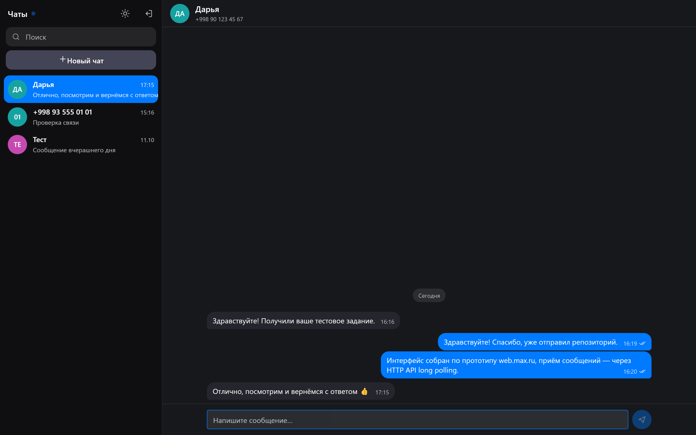
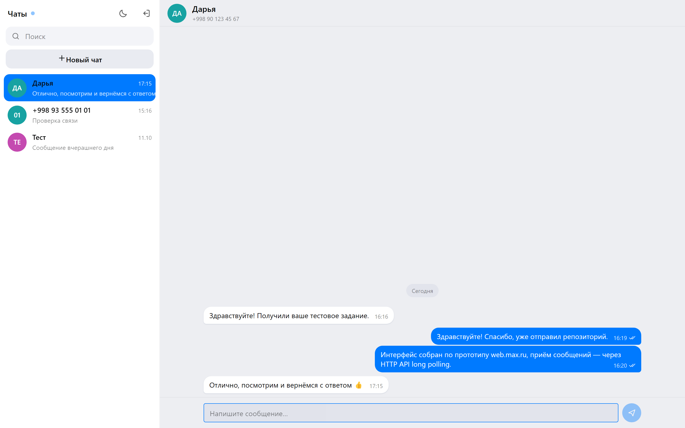
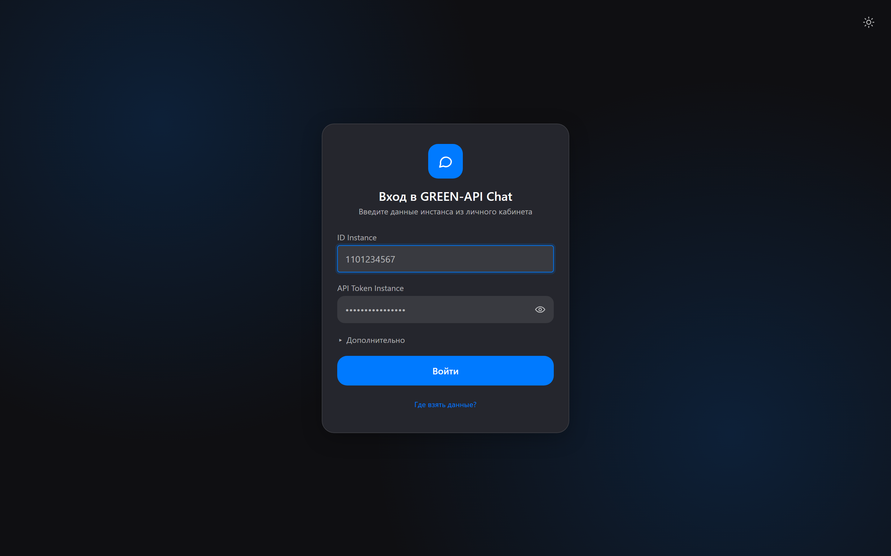
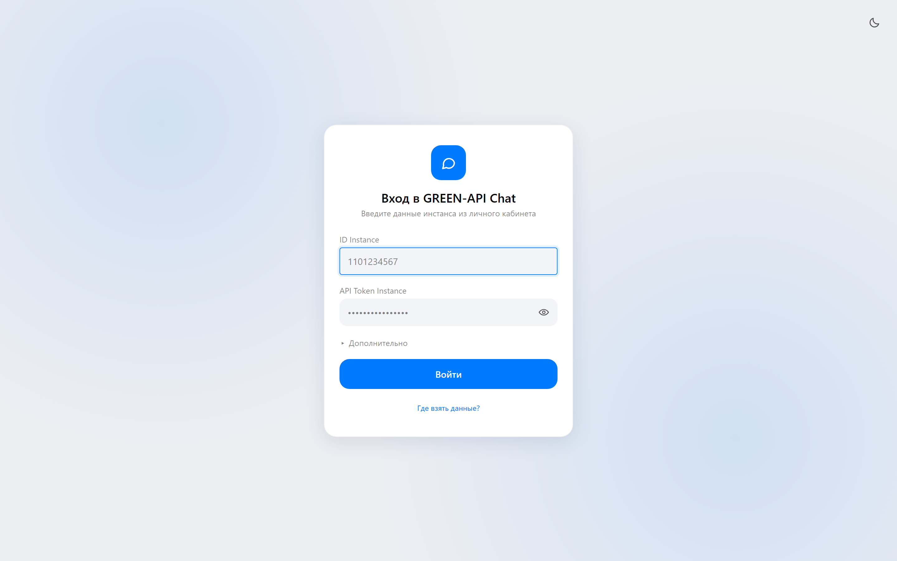
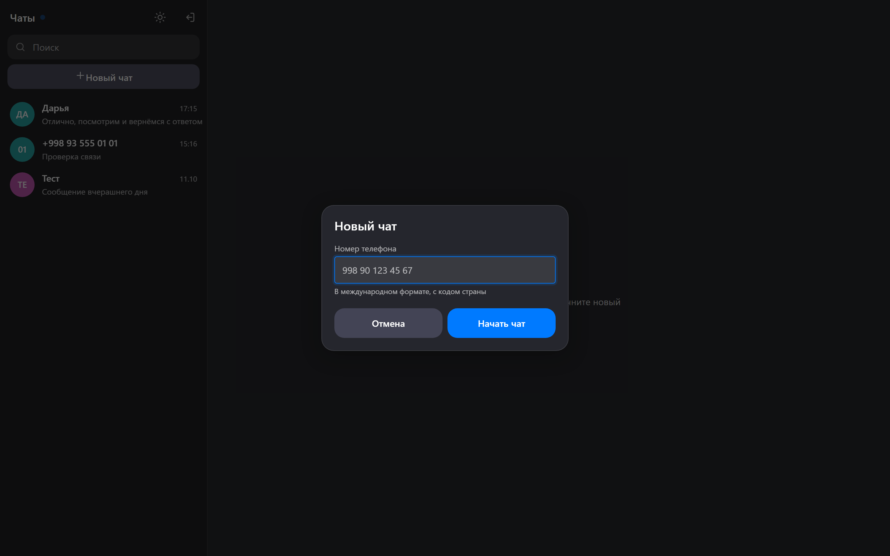
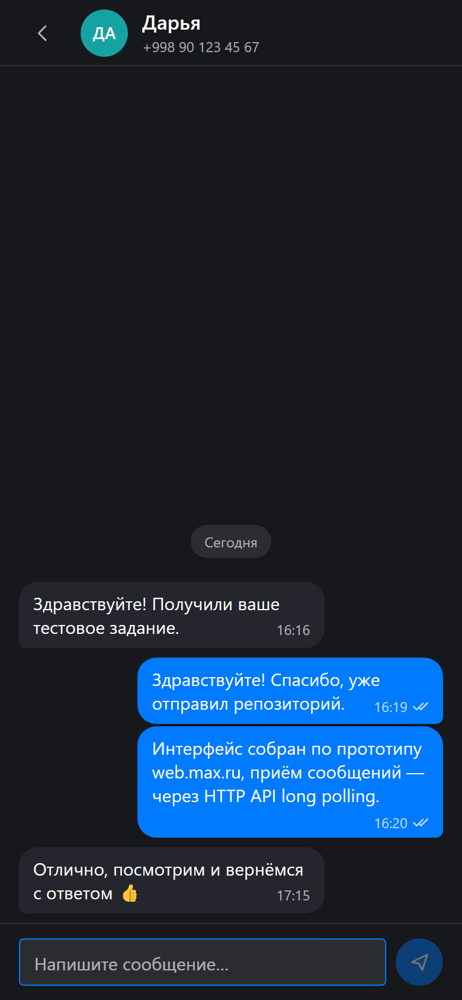

# GREEN-API Chat

Веб-чат для отправки и получения текстовых сообщений через [GREEN-API](https://green-api.com).
Тестовое задание на должность **Фронтенд разработчик React**.

Интерфейс построен по прототипу [web.max.ru](https://web.max.ru): цветовые токены,
радиусы и типографика сняты с реального интерфейса MAX, светлая и тёмная темы.



> 👉 **Проверяющему:** пошаговая инструкция «как попробовать» —
> [docs/USAGE.md](docs/USAGE.md). Там же разбор по пунктам задания
> и что делать, если что-то не заработало. Весь путь — около 5 минут.

---

## Скриншоты

| Тёмная тема                                          | Светлая тема                                           |
| ---------------------------------------------------- | ------------------------------------------------------ |
|   |   |
|  |  |

| Новый чат                                            | Мобильная вёрстка                                                               |
| ---------------------------------------------------- | ------------------------------------------------------------------------------- |
|  |  |

---

## Что внутри

|           |                                                  |
| --------- | ------------------------------------------------ |
| Сборка    | Vite 6                                           |
| Язык      | TypeScript (strict)                              |
| UI        | React 19, CSS Modules, без UI-библиотек          |
| Состояние | Context + useReducer                             |
| Хранение  | localStorage (учётные данные и история)          |
| Тесты     | Vitest + Testing Library — 24 теста              |
| Качество  | ESLint, Prettier, `tsc --noEmit`, GitHub Actions |

Зависимостей в рантайме ровно две: `react` и `react-dom`.

---

## Запуск

Нужен Node.js 20+.

```bash
npm install
npm run dev
```

Приложение откроется на <http://localhost:5173>.

### Остальные команды

```bash
npm run build      # typecheck + production-сборка в dist/
npm run preview    # посмотреть собранную версию
npm run test       # прогнать тесты
npm run lint       # ESLint
npm run typecheck  # tsc --noEmit
```

---

## Как начать пользоваться

Коротко:

1. Создайте инстанс на [green-api.com](https://green-api.com) — бесплатный тариф «Developer».
2. В [личном кабинете](https://console.green-api.com/) привяжите телефон: отсканируйте
   QR-код в WhatsApp → Связанные устройства.
3. Скопируйте **idInstance** и **apiTokenInstance**, введите их на экране входа.
4. «Новый чат» → номер в международном формате (`998901234567`) → отправьте сообщение.
5. Ответ получателя появится в чате сам, без перезагрузки.

При входе приложение вызывает `setSettings` и включает очередь уведомлений для
HTTP API. Инстанс после этого перезагружается примерно минуту — если первые
сообщения не приходят, подождите и обновите страницу.

📖 **Подробная версия с разбором по пунктам задания и решением типичных
проблем — [docs/USAGE.md](docs/USAGE.md).**

---

## Как это устроено

```
src/
├── api/
│   ├── client.ts          # единая точка вызова, нормализация ошибок
│   ├── greenApi.ts        # методы GREEN-API
│   └── transport/         # канал доставки уведомлений
│       ├── types.ts       #   интерфейс NotificationTransport
│       └── polling.ts     #   реализация на long polling
├── components/ui/         # Button, TextField, Avatar, Spinner, EmptyState
├── features/
│   ├── auth/              # экран входа и работа с учётными данными
│   └── chat/              # layout, сайдбар, лента, composer
│       └── model/         # reducer, chatId, персистентность
├── hooks/                 # useNotifications, useAutoScroll, useTheme
├── i18n/ru.ts             # все тексты в одном месте
└── styles/tokens.css      # дизайн-токены
```

### Отправка

`SendMessage` → `{apiUrl}/waInstance{id}/sendMessage/{token}`.
Сообщение показывается в ленте сразу, оптимистично, со статусом «отправляется».
После ответа сервера локальный id заменяется на `idMessage`, статус меняется на
«отправлено». При ошибке появляется кнопка «Отправить ещё раз».

### Приём

Приём реализован через **HTTP API (long polling)** — технология, указанная в
задании. Цикл строго последовательный:

```
receiveNotification(20s) → обработать → deleteNotification(receiptId) → снова
```

Важные детали:

- `deleteNotification` вызывается в `finally`. Если этого не сделать, очередь
  встанет: одно и то же уведомление будет приходить бесконечно, а новые не придут.
- При ошибке — экспоненциальная задержка 1 → 2 → 4 … до 30 секунд.
- Если сервер отвечает «пусто» мгновенно, добавляется пауза, чтобы цикл
  не превратился в busy loop.
- Повтор запуска игнорируется — иначе React StrictMode в dev поднял бы два цикла.
- Дедупликация по `idMessage`: собственные сообщения возвращаются эхом через
  `outgoingAPIMessageReceived`.

### Почему не WebSocket

У GREEN-API нет WebSocket для уведомлений: в документации описаны только
HTTP API и Webhook Endpoint, а вебхук требует собственного бэкенда с публичным
адресом. WebSocket у сервиса используется лишь для получения QR-кода при
привязке устройства.

Поэтому приём абстрагирован интерфейсом `NotificationTransport`: сейчас это
`pollingTransport`, и добавление другого канала не затронет стор и UI.

### CORS

По умолчанию браузер обращается к GREEN-API напрямую. Если в вашем окружении
запросы блокируются CORS, включите dev-прокси:

```bash
# .env.local
VITE_USE_PROXY=true
```

Прокси описан в `vite.config.ts`. Базовый URL собирается в одном месте
(`src/api/client.ts`), поэтому переключение не затрагивает остальной код.

---

## Интерфейс

- Светлая и тёмная темы, по умолчанию — системная настройка
- Адаптивность: на экранах уже 768px видна одна панель, в шапке появляется «Назад»
- Enter отправляет, Shift+Enter переносит строку, поле растёт до 6 строк
- Группировка сообщений по дням, разделители «Сегодня» / «Вчера»
- Статусы: отправляется / отправлено / доставлено / прочитано / ошибка
- Индикатор состояния подключения в шапке сайдбара
- Доступность: навигация с клавиатуры, `aria-live` на ленте сообщений,
  `:focus-visible`, поддержка `prefers-reduced-motion`

---

## Ограничения

- Поддерживаются только **текстовые** сообщения и только **личные** чаты —
  как требуется в задании. Медиа и группы отфильтровываются.
- Бэкенда нет: `idInstance` и `apiTokenInstance` хранятся в `localStorage`
  браузера и отправляются только в GREEN-API. Для теста это приемлемо;
  в продакшене токены должны жить на сервере, а запросы идти через него.
  Кнопка «Выйти» очищает хранилище.
- История ограничена последними 200 сообщениями на чат.

## Дальнейшее развитие

- Небольшой бэкенд: принимает вебхуки GREEN-API и раздаёт их браузеру
  по WebSocket/SSE — это уберёт polling и спрячет токены на сервере.
- Медиасообщения, цитирование, индикатор «печатает».
- Виртуализация ленты для очень длинных переписок.
